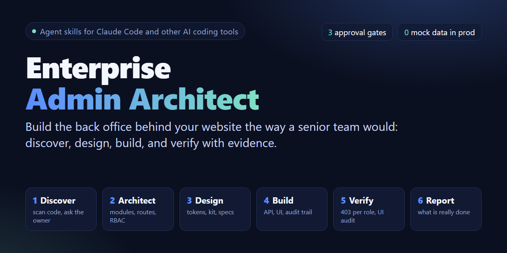

<p align="center"></p>

# Enterprise Admin Architect

**English** · [Tiếng Việt](README.vi.md)

[](https://github.com/kat-minh/enterprise-admin-architect/actions/workflows/ci.yml)
[](LICENSE)

A suite of **agent skills** that guides an AI assistant through building a **professional, enterprise-grade admin system (back office / CMS)** for a website you have already built - instead of the usual generic dashboard (a sidebar, four stat cards and a few CRUD tables).

> The public website serves its users. **The admin system operates the business behind it.**

The skills enforce the right order: **analyse the website → design the admin architecture → build the design system → implement module by module → verify for real**, with approval gates where you decide. They use the open Agent Skills layout (`SKILL.md`), run natively in **Claude Code**, and work with **any AI assistant** through an instruction file or a copy-paste bundle - see [Install](#install).

## Quick start

```text
/plugin marketplace add kat-minh/enterprise-admin-architect
/plugin install enterprise-admin-architect@enterprise-admin-architect
/enterprise-admin-architect
```
Using another AI tool? See [Install](#install). Prefer to see the result first? Browse [`examples/e-commerce/docs/admin`](examples/e-commerce/docs/admin).

## What you get

Excerpt from the sample output in [`examples/e-commerce`](examples/e-commerce/docs/admin) (illustrative project):

```text
Overview            Dashboard
Sales               Orders · Returns & Refunds · Payments
Catalog             Products · Categories · Inventory · Coupons
Customers           Customers · Reviews · Contact Inbox
Content             Media · FAQ & Pages
Settings & Access   Admin Users · Roles & Permissions · Audit Log · Settings
```

| ID | Module | Layer | Evidence | Priority | Source / Justification |
|---|---|---|---|---|---|
| orders | Orders | domain | confirmed | P0 | Prisma `Order` + `OrderStatus` enum; `/api/orders` |
| refunds-returns | Returns & Refunds | domain | implied | P1 | Orders can be PAID/SHIPPED; no way to reverse them yet |
| leads-inbox | Contact Inbox | foundation | confirmed | P1 | `/contact` form posts to `/api/contact` and nothing reads it |
| notifications | Notifications | foundation | proposed | P2 | Useful for new-order alerts; needs your approval |

Plus a role × permission matrix (for example `orders.refund` only for Finance), per-module specifications, a design system, and a QA report that records what was actually verified.

## Proven, not promised

The suite was proven by using it to build a full-stack admin (backend, separate admin app, public app untouched) for a real consumer web app, on clones of the project and a throw-away database. What that run produced, and what the gates caught on the way:

- **Server-side enforcement, tested per role:** a role × endpoint matrix against the API (403 when forbidden, not only a hidden button), with the matrix document read at run time as the oracle.
- **Dashboard figures verified independently:** every metric recomputed from raw rows in plain code and compared for 7, 30 and 90 days, including boundary rows at the edge of a day in the business time zone.
- **UI audit before the owner has to point things out:** every page × role × phone / tablet / desktop × light / dark; it found a second scrollbar, clipped text, contrast failures, a popover spilling out of its card, and a widget that asked for data its role may not see.
- **Large data:** 200,000 users and 400,000 trips; list endpoints that were 1.5-8 s became sub-second after the recipe in the QA playbook.
- **Public product untouched** except where intended; editing texts, banners and brand colours in the admin was verified in the real public app (draft invisible, preview, publish, rollback, endpoint down).
- **A delegated agent's work re-verified on a separate stack** before it was believed.

What is only guidance, and what is deliberately left out, is listed in [`docs/coverage-map.md`](docs/coverage-map.md).

## Why it exists

| Common problem | How the suite handles it |
|---|---|
| The assistant jumps straight into a CRUD dashboard | Three approval gates; no admin code until the module inventory is approved |
| Modules invented without a link to the business | Every module carries an evidence tag: `confirmed` / `implied` / `proposed` (needs your approval) |
| Mandatory and domain-specific modules mixed together | Three layers: **core** (every web needs it) → **foundation** (conditional) → **domain** (derived from the real business) |
| Dashboards full of placeholder numbers | "Real or documented": no mock data in production, no fake success; missing backend goes into a gap list |
| Permissions = hiding buttons | RBAC enforced on the server; tests prove the API returns 403 per role |
| "Done" when the page merely renders | `done` only with a working workflow and recorded evidence; a validator cross-checks the docs |
| Every page styled differently | Tokens first, shared components, specs for table/form/detail/dashboard, reuse of your existing UI kit |
| You want to review the UI before any backend exists | **FE-first mode**: approve the UI on a guarded mock layer, then build the backend to a frozen API contract |

## What's in the suite

| Skill | Role | Output |
|---|---|---|
| `enterprise-admin-architect` | **Orchestrator** (start here): principles, gates, resume | - |
| `admin-discovery` | Phase 1: scan code, domain map, module inventory, backend gaps | `product-discovery.md`, `business-domain-map.md`, `module-inventory.md` |
| `admin-information-architecture` | Phase 2-3: sidebar, routes, drawer/page/modal, roles & permission matrix | `information-architecture.md`, `permission-matrix.md` |
| `admin-design-system` | Phase 4: tokens, app shell, table/form/detail/dashboard, accessibility, locale | `design-system.md` + shell + a reference module |
| `admin-module-builder` | Phase 5-7: spec → backend → UI → RBAC → audit → security | `module-specifications/*.md`, code, `implementation-status.md` |
| `admin-qa-gate` | Phase 8: validator, permission/workflow/state tests, honest report | `qa-report.md` |
| `admin-ui-audit` | **Standalone**: audit and fix the UI of an *existing* admin (automated browser audit per role × width × theme, visual review, dashboard and performance pass) | findings table + screenshots |

Also included:
- `admin-discovery/scripts/scan-project.mjs` - project scanner (stack, routes, API, models, enums/status, existing admin, roles, public forms, env var **names only**).
- `admin-qa-gate/scripts/validate-admin-docs.mjs` - documentation consistency checker (module ↔ permission ↔ route ↔ spec ↔ verification evidence).
- `admin-discovery/references/domains/` - 15 domain playbooks (e-commerce, travel/booking, education, corporate, news, SaaS, marketplace, clinic/appointments, real estate, job board, F&B, events/ticketing, community/UGC, fintech/KYC, consumer app / PWA) plus a playbook for unusual domains.
- `scripts/bundle.mjs` - builds a self-contained prompt per phase (including `ui-audit`) for chat-only assistants.
- [`docs/coverage-map.md`](docs/coverage-map.md) - what the suite covers against the usual "admin dashboard toolkit" wish-list, at what level (proven / gate / tool / guidance), and what is deliberately left out.
- `examples/e-commerce/` - a complete sample `docs/admin` that passes the validator.

Both scripts are dependency-free Node (>= 18) and make no network requests.

## Install

| You use | How |
|---|---|
| **Claude Code** | Plugin: `/plugin marketplace add kat-minh/enterprise-admin-architect` then `/plugin install enterprise-admin-architect@enterprise-admin-architect` |
| A tool that supports **Agent Skills** (`SKILL.md`) | Copy every folder from `skills/` into the tool's skills directory (project or user level) |
| A tool that reads an **instruction file** (`AGENTS.md`, `CLAUDE.md`, `GEMINI.md`, Cursor rules…) | Keep `skills/` in the repo and add a short pointer to the orchestrator |
| A **chat-only** assistant | `node scripts/bundle.mjs <phase> --out bundle.md`, then paste one phase per conversation |

Details, snippets and caveats: [docs/using-with-other-ai-tools.md](docs/using-with-other-ai-tools.md).

Manual copy for any skills-capable tool (copy **every** folder; they reference each other):
```bash
cp -r skills/* <your-project>/.claude/skills/      # or your tool's skills directory
```
```powershell
Copy-Item -Recurse .\skills\* <your-project>\.claude\skills\
```

## Usage: three working sessions

Once your main website is built, start the orchestrator. In Claude Code run `/enterprise-admin-architect`; in other tools ask: *"Build the admin for this project. Follow `skills/enterprise-admin-architect/SKILL.md`."*

| Session | What happens | Gate you approve |
|---|---|---|
| **1. Discovery & Architecture** | Reads code, routes and database; builds the domain map, module list (core/foundation/domain, P0-P2), sidebar, roles, permission matrix, backend gaps and ≤ 7 questions with recommended defaults | **Gate 1**: which modules, which roles, what backend is missing, delivery mode |
| **2. UI/UX & Design System** | Tokens, app shell, shared components, **one complete reference module** | **Gate 2**: look and feel, interaction patterns |
| **3. Implement & QA** | Builds each module (spec → API → UI → permissions → audit), verifies after each, final report | **Gate 3**: QA report and remaining work |

Natural-language requests also work: *"analyse this site and list the admin modules it needs"* (discovery), *"redesign the admin menu and permissions"* (architecture), *"implement the Orders module"* (builder), *"QA the admin, check permissions"* (QA). A request such as *"just build it"* still produces a compact analysis with written assumptions; server-side permissions, audit logging and verification are never skipped.

### FE-first mode: see the UI before the backend

At Gate 1 you choose the **delivery mode**:

| Mode | When | Flow |
|---|---|---|
| `full-stack` | The repo already has the APIs/DB the admin needs, or the backend is small | Build each module against real APIs |
| `fe-first` | You want to **review and approve the UI first**, or most P0 backend work is missing | Write the **API contract** → build the whole UI on a **guarded mock layer** → **Gate 2b (FE Preview)**: you click through it and give feedback → freeze the contract → build the backend to it → swap mock → real per module → QA |

How the mock layer stays honest (details: [`fe-first-mock-layer.md`](skills/admin-module-builder/references/fe-first-mock-layer.md)):
- The UI calls only a **service interface**; the mock and the real API implement the same interface, so swapping is one line and no UI work is discarded.
- The mock **behaves like a server**: server-side pagination/filter/sort, latency, 422/403/409 errors, state machines.
- Every page shows a **"Prototype data"** banner; a role switcher previews each role; toggles force empty/error/slow/forbidden states.
- **Blocked in production** by a deployment-environment variable (not `NODE_ENV`, because preview builds on common platforms also run with `NODE_ENV=production`) plus a bundle check; previews must be access-protected and `noindex`.
- Mock-backed modules have status `prototype` and can **never** be `done`; the validator fails if a `done` module still uses mock data or a `prototype` module has no `api-contract.md`.

## Generated documents

```
docs/admin/
  product-discovery.md   business-domain-map.md   module-inventory.md
  information-architecture.md   permission-matrix.md   design-system.md
  module-specifications/<module-id>.md
  api-contract.md            (required in fe-first mode)
  implementation-status.md   qa-report.md
```
`module-inventory.md` is the **single source of truth** for module status; `implementation-status.md` holds the verification evidence. Check them at any time:

```bash
node skills/admin-discovery/scripts/scan-project.mjs <project> --md
node skills/admin-qa-gate/scripts/validate-admin-docs.mjs --root <project> --stage build
```

**Language:** the assistant replies and writes the free-text content in your language, but keeps section headings, table column headers and enum values (`core`, `P0`, `in-progress`…) in English exactly as in the templates, because the validator checks them.

## Module layers

- **core** (mandatory for every web): authentication & sessions, RBAC, domain-aware dashboard, admin accounts, audit log, settings, my account/security.
- **foundation** (conditional; exclusion needs a stated reason): users/customers, notifications, media, import/export, trash, **site content & UI** (UI text and translations, brand and theme accent, banners, static pages, menus, SEO, redirects, with draft, preview, publish and rollback, for websites **and apps**), **leads inbox** (forms, feedback, reports), message templates, **user messaging**, **jobs, integrations and system health**, **runtime controls** (kill switches, flags, maintenance mode), **privacy requests**, search/command menu, localization.
- **domain** (derived from your website): Orders, Bookings, Courses, Articles, Organizations… or modules for an unusual business.

## Design principles

1. **Evidence over imagination** - modules trace to code, data or a confirmed requirement.
2. **Layered scope** - a stable core, conditional foundations, and domain modules only where the business needs them.
3. **Gates and contracts** - humans approve scope, UI and results; FE-first work is contract-first.
4. **Executable verification** - a scanner and a validator back the process; QA proves behaviour (including API-level 403s), not appearance.
5. **Secure by default** - server-side authorization, append-only audit, IDOR/mass-assignment/upload/export safeguards, safe destructive operations.
6. **Progressive disclosure** - short `SKILL.md` files; details load from `references/` only when needed.
7. **Tool-neutral** - plain Markdown and dependency-free scripts; optional capabilities always have a fallback.
8. **Locale-aware** - currency, timezone, accent-insensitive search and font coverage (with Vietnamese as a worked case).

## Project status

Version 1.x. Covered by automated tests (scanner, documentation validator, bundler), repository checks and CI. The workflow itself has not yet been benchmarked on large production codebases.

- The scanner is regex-based: a **map, not truth**. Unusual frameworks or complex monorepos may be missed; the skills instruct the assistant to confirm by reading the files.
- Gates are instructions to the assistant, not hard locks; review the output at each gate.
- Stack adapters (Ant Design, shadcn/ui, MUI…) describe typical APIs; verify against your installed versions.
- Primary target is Claude Code; other tools use the same open format but are not exercised in CI.

Field reports are the most useful contribution - see [CONTRIBUTING.md](CONTRIBUTING.md).

## Contributing, security, license

- Contributions are welcome: [CONTRIBUTING.md](CONTRIBUTING.md) (agents working on this repo: [AGENTS.md](AGENTS.md)).
- Report vulnerabilities privately: [SECURITY.md](SECURITY.md).
- Licensed under the [MIT License](LICENSE).
