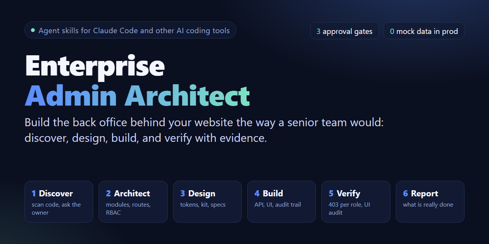

<p align="center"></p>

# Enterprise Admin Architect

[English](README.md) · **Tiếng Việt**

[](https://github.com/kat-minh/enterprise-admin-architect/actions/workflows/ci.yml)
[](LICENSE)

Bộ **agent skill** hướng dẫn trợ lý AI dựng một **hệ thống admin / back-office / CMS chuyên nghiệp, chuẩn enterprise** cho website đã có sẵn - thay vì một dashboard chung chung (sidebar, bốn thẻ thống kê và vài bảng CRUD).

> Website chính phục vụ người dùng. **Hệ thống admin vận hành doanh nghiệp đứng sau website đó.**

Bộ skill buộc quy trình đúng thứ tự: **phân tích website → thiết kế kiến trúc admin → dựng design system → triển khai từng module → kiểm chứng thật**, với các cổng duyệt để bạn quyết định. Skill dùng định dạng mở Agent Skills (`SKILL.md`), chạy trực tiếp trong **Claude Code**, và dùng được với **mọi trợ lý AI** qua file chỉ dẫn hoặc bundle dán trực tiếp - xem [Cài đặt](#cài-đặt).

## Bắt đầu nhanh

```text
/plugin marketplace add kat-minh/enterprise-admin-architect
/plugin install enterprise-admin-architect@enterprise-admin-architect
/enterprise-admin-architect
```
Dùng công cụ AI khác? Xem [Cài đặt](#cài-đặt). Muốn xem kết quả trước? Mở [`examples/e-commerce/docs/admin`](examples/e-commerce/docs/admin).

## Bạn nhận được gì

Trích từ output mẫu trong [`examples/e-commerce`](examples/e-commerce/docs/admin) (project minh hoạ):

```text
Overview            Dashboard
Sales               Orders · Returns & Refunds · Payments
Catalog             Products · Categories · Inventory · Coupons
Customers           Customers · Reviews · Contact Inbox
Content             Media · FAQ & Pages
Settings & Access   Admin Users · Roles & Permissions · Audit Log · Settings
```

| ID | Module | Layer | Evidence | Priority | Source / Justification |
|---|---|---|---|---|---|
| orders | Orders | domain | confirmed | P0 | Prisma `Order` + enum `OrderStatus`; `/api/orders` |
| refunds-returns | Returns & Refunds | domain | implied | P1 | Đơn PAID/SHIPPED hiện chưa có cách hoàn lại |
| leads-inbox | Contact Inbox | foundation | confirmed | P1 | Form `/contact` gửi tới `/api/contact` nhưng chưa có nơi đọc |
| notifications | Notifications | foundation | proposed | P2 | Hữu ích cho cảnh báo đơn mới; cần bạn duyệt |

Kèm ma trận role × quyền (ví dụ `orders.refund` chỉ dành cho Finance), spec từng module, design system và báo cáo QA ghi lại những gì thực sự đã được kiểm chứng.

## Vì sao cần bộ skill này

| Vấn đề thường gặp | Cách bộ skill xử lý |
|---|---|
| Trợ lý lao ngay vào code dashboard CRUD | 3 cổng duyệt; không viết code admin trước khi danh sách module được duyệt |
| Module bịa ra, không gắn với nghiệp vụ | Mỗi module có nhãn bằng chứng: `confirmed` / `implied` / `proposed` (cần bạn duyệt) |
| Module bắt buộc và module đặc thù lẫn lộn | 3 lớp: **core** (web nào cũng cần) → **foundation** (có điều kiện) → **domain** (sinh từ nghiệp vụ thật) |
| Dashboard toàn số liệu giả | "Real or documented": không dùng mock ở production, không giả lập thành công; thiếu backend thì ghi vào danh sách gap |
| Phân quyền chỉ là ẩn nút | RBAC kiểm tra ở server; test chứng minh API trả 403 theo từng role |
| "Xong" khi trang mới chỉ render được | `done` chỉ khi workflow chạy thật và có bằng chứng; validator đối chiếu tài liệu |
| Mỗi trang một kiểu giao diện | Tokens trước, component dùng chung, spec cho table/form/detail/dashboard, tái dùng UI kit sẵn có |
| Muốn duyệt giao diện trước khi có backend | **Chế độ FE-first**: duyệt UI trên mock layer có kiểm soát, rồi build backend theo API contract đã chốt |

## Bộ skill gồm gì

| Skill | Vai trò | Đầu ra |
|---|---|---|
| `enterprise-admin-architect` | **Điều phối** (bắt đầu từ đây): nguyên tắc, các gate, tiếp tục công việc dở | - |
| `admin-discovery` | Phase 1: quét code, domain map, danh sách module, backend gap | `product-discovery.md`, `business-domain-map.md`, `module-inventory.md` |
| `admin-information-architecture` | Phase 2-3: sidebar, route, drawer/page/modal, role & ma trận phân quyền | `information-architecture.md`, `permission-matrix.md` |
| `admin-design-system` | Phase 4: tokens, app shell, table/form/detail/dashboard, accessibility, locale | `design-system.md` + shell + module mẫu |
| `admin-module-builder` | Phase 5-7: spec → backend → UI → RBAC → audit → bảo mật | `module-specifications/*.md`, code, `implementation-status.md` |
| `admin-qa-gate` | Phase 8: validator, test phân quyền/workflow/trạng thái, báo cáo trung thực | `qa-report.md` |
| `admin-ui-audit` | **Dùng riêng**: audit và sửa giao diện của một admin *đã có* (audit trình duyệt tự động theo vai trò × độ rộng × theme, review bằng mắt, dashboard, hiệu năng) | bảng phát hiện + ảnh chụp |

Kèm theo:
- `admin-discovery/scripts/scan-project.mjs` - quét project (stack, route, API, model, enum/status, admin có sẵn, role, form công khai, **chỉ tên** biến môi trường).
- `admin-qa-gate/scripts/validate-admin-docs.mjs` - kiểm tra tài liệu nhất quán (module ↔ quyền ↔ route ↔ spec ↔ bằng chứng verify).
- `admin-discovery/references/domains/` - 15 playbook domain (e-commerce, app người dùng cuối/PWA, du lịch/booking, giáo dục, corporate, tin tức, SaaS, marketplace, phòng khám/đặt lịch, bất động sản, tuyển dụng, F&B, sự kiện/vé, cộng đồng/UGC, fintech/KYC) và một playbook cho domain đặc thù.
- `scripts/bundle.mjs` - tạo prompt tự đủ cho từng phase (gồm `ui-audit`), dành cho trợ lý chỉ có giao diện chat.
- [`docs/coverage-map.md`](docs/coverage-map.md) - bộ skill phủ những gì so với danh sách "admin dashboard toolkit" thường gặp, ở mức nào (đã chứng minh / có gate / có công cụ / chỉ hướng dẫn) và cố ý bỏ gì (tiếng Anh).
- `examples/e-commerce/` - bộ `docs/admin` mẫu hoàn chỉnh, qua được validator.

Hai script đều là Node thuần (>= 18), không có dependency và không gọi mạng.

## Cài đặt

| Bạn dùng | Cách cài |
|---|---|
| **Claude Code** | Plugin: `/plugin marketplace add kat-minh/enterprise-admin-architect` rồi `/plugin install enterprise-admin-architect@enterprise-admin-architect` |
| Công cụ hỗ trợ **Agent Skills** (`SKILL.md`) | Copy cả sáu thư mục trong `skills/` vào thư mục skills của công cụ (cấp project hoặc cấp người dùng) |
| Công cụ đọc **file chỉ dẫn** (`AGENTS.md`, `CLAUDE.md`, `GEMINI.md`, Cursor rules…) | Để `skills/` trong repo và thêm một đoạn trỏ tới skill điều phối |
| Trợ lý **chỉ có chat** | `node scripts/bundle.mjs <phase> --out bundle.md`, rồi dán từng phase vào từng cuộc hội thoại |

Chi tiết, đoạn mẫu và lưu ý: [docs/using-with-other-ai-tools.md](docs/using-with-other-ai-tools.md) (tiếng Anh).

Copy thủ công cho công cụ hỗ trợ skills (copy **cả sáu** thư mục vì chúng tham chiếu lẫn nhau):
```bash
cp -r skills/* <your-project>/.claude/skills/      # hoặc thư mục skills của công cụ bạn dùng
```
```powershell
Copy-Item -Recurse .\skills\* <your-project>\.claude\skills\
```

## Cách dùng: ba phiên làm việc

Khi website chính đã xong, khởi động skill điều phối. Trong Claude Code gõ `/enterprise-admin-architect`; với công cụ khác, hãy yêu cầu: *"Dựng admin cho project này. Làm theo `skills/enterprise-admin-architect/SKILL.md`."*

| Phiên | Nội dung | Gate bạn duyệt |
|---|---|---|
| **1. Discovery & Architecture** | Đọc code, route, database; lập domain map, danh sách module (core/foundation/domain, P0-P2), sidebar, role, ma trận phân quyền, backend gap và ≤ 7 câu hỏi kèm đề xuất mặc định | **Gate 1**: module nào, role nào, thiếu backend gì, chế độ triển khai |
| **2. UI/UX & Design System** | Tokens, app shell, component dùng chung, **một module mẫu hoàn chỉnh** | **Gate 2**: giao diện, cách tương tác |
| **3. Implement & QA** | Build từng module (spec → API → UI → phân quyền → audit), verify sau mỗi module, báo cáo cuối | **Gate 3**: báo cáo QA và việc còn lại |

Bạn cũng có thể yêu cầu bằng ngôn ngữ tự nhiên: *"phân tích web này và liệt kê module admin cần có"* (discovery), *"thiết kế lại menu và phân quyền admin"* (architecture), *"implement module Orders"* (builder), *"QA admin, kiểm tra quyền"* (QA). Yêu cầu kiểu *"làm luôn"* vẫn cho ra một bản phân tích gọn kèm assumptions; phân quyền ở server, audit log và bước verify không bao giờ bị bỏ qua.

### Chế độ FE-first: xem giao diện trước, làm backend sau

Ở Gate 1 bạn chọn **delivery mode**:

| Mode | Khi nào | Luồng |
|---|---|---|
| `full-stack` | Repo đã có API/DB cho admin, hoặc backend nhỏ | Build từng module trên API thật |
| `fe-first` | Muốn **xem và duyệt UI trước**, hoặc phần lớn backend P0 chưa có | Viết **API contract** → build toàn bộ UI trên **mock layer có kiểm soát** → **Gate 2b (FE Preview)**: bạn thao tác thử và góp ý → chốt contract → build backend theo contract → đổi mock sang API thật từng module → QA |

Cách mock layer giữ được tính trung thực (chi tiết: [`fe-first-mock-layer.md`](skills/admin-module-builder/references/fe-first-mock-layer.md)):
- UI chỉ gọi **service interface**; mock và API thật cùng cài interface đó, nên đổi nguồn dữ liệu chỉ một dòng và không bỏ phí công làm UI.
- Mock **hành xử như server thật**: phân trang/lọc/sắp xếp phía server, độ trễ, lỗi 422/403/409, state machine.
- Mọi trang hiển thị banner **"Prototype data"**; có role switcher xem theo từng role; có công tắc ép trạng thái empty/error/slow/forbidden.
- **Bị chặn ở production** bằng biến môi trường triển khai (không dùng `NODE_ENV`, vì build preview trên các nền tảng phổ biến cũng chạy với `NODE_ENV=production`) và kiểm tra bundle; preview phải có bảo vệ truy cập và `noindex`.
- Module chạy trên mock có trạng thái `prototype` và **không bao giờ** được là `done`; validator báo lỗi nếu module `done` vẫn dùng mock hoặc module `prototype` thiếu `api-contract.md`.

## Tài liệu được sinh ra

```
docs/admin/
  product-discovery.md   business-domain-map.md   module-inventory.md
  information-architecture.md   permission-matrix.md   design-system.md
  module-specifications/<module-id>.md
  api-contract.md            (bắt buộc ở chế độ fe-first)
  implementation-status.md   qa-report.md
```
`module-inventory.md` là **nguồn sự thật duy nhất** về trạng thái module; `implementation-status.md` lưu bằng chứng verify. Có thể kiểm tra bất cứ lúc nào:

```bash
node skills/admin-discovery/scripts/scan-project.mjs <project> --md
node skills/admin-qa-gate/scripts/validate-admin-docs.mjs --root <project> --stage build
```

**Ngôn ngữ:** trợ lý trả lời và viết phần nội dung tự do bằng ngôn ngữ của bạn, nhưng giữ nguyên tiếng Anh cho tiêu đề mục, tiêu đề cột bảng và giá trị enum (`core`, `P0`, `in-progress`…) đúng như template, vì validator kiểm tra các phần này.

## Các lớp module

- **core** (bắt buộc với mọi web): xác thực & phiên, RBAC, dashboard theo nghiệp vụ, tài khoản admin, audit log, cài đặt, tài khoản/bảo mật cá nhân.
- **foundation** (có điều kiện; loại bỏ phải nêu lý do): người dùng/khách hàng, thông báo, media, import/export, thùng rác, **site content & UI** (chữ giao diện và bản dịch, thương hiệu và màu nhấn, banner, trang tĩnh, menu, SEO, redirect; có bản nháp, xem thử, xuất bản và quay lại; cho cả website **và app**), **leads inbox** (form, phản hồi, báo cáo), mẫu tin nhắn, **nhắn tin tới người dùng**, **job, tích hợp và sức khoẻ hệ thống**, **công tắc vận hành** (kill switch, feature flag, chế độ bảo trì), **yêu cầu quyền riêng tư**, tìm kiếm/command menu, đa ngôn ngữ.
- **domain** (sinh từ website của bạn): Orders, Bookings, Courses, Articles, Organizations… hoặc module riêng cho nghiệp vụ đặc thù.

## Nguyên tắc thiết kế

1. **Bằng chứng hơn tưởng tượng** - mỗi module truy được về code, dữ liệu hoặc yêu cầu đã xác nhận.
2. **Phạm vi phân lớp** - lõi ổn định, nền tảng có điều kiện, module domain chỉ khi nghiệp vụ cần.
3. **Gate và contract** - con người duyệt phạm vi, giao diện và kết quả; FE-first đi theo hướng contract-first.
4. **Kiểm chứng chạy được** - scanner và validator hỗ trợ quy trình; QA chứng minh hành vi (kể cả 403 ở tầng API), không chỉ vẻ ngoài.
5. **An toàn mặc định** - phân quyền server-side, audit chỉ-ghi-thêm, chống IDOR/mass-assignment/upload/export độc hại, thao tác phá huỷ an toàn.
6. **Tiết lộ dần** - `SKILL.md` ngắn; chi tiết chỉ nạp từ `references/` khi cần.
7. **Không phụ thuộc công cụ** - Markdown thuần và script không dependency; tính năng tuỳ chọn luôn có phương án thay thế.
8. **Nhận biết địa phương** - tiền tệ, múi giờ, tìm kiếm không dấu, font hỗ trợ tiếng Việt (lấy tiếng Việt làm ví dụ cụ thể).

## Trạng thái dự án

Phiên bản 1.x. Có test tự động (scanner, validator tài liệu, bundler), kiểm tra repo và CI. Quy trình chưa được đo kiểm trên các codebase production lớn.

- Scanner dựa trên regex: là **bản đồ, không phải sự thật**. Framework lạ hoặc monorepo phức tạp có thể bị sót; skill yêu cầu trợ lý xác nhận bằng cách đọc file.
- Các gate là chỉ dẫn cho trợ lý, không phải khoá cứng; hãy xem lại đầu ra ở mỗi gate.
- Phần stack adapters (Ant Design, shadcn/ui, MUI…) mô tả API điển hình; hãy đối chiếu với phiên bản bạn đang dùng.
- Đối tượng chính là Claude Code; các công cụ khác dùng cùng định dạng mở nhưng không được kiểm thử trong CI.

Báo cáo thực tế khi dùng là đóng góp hữu ích nhất - xem [CONTRIBUTING.md](CONTRIBUTING.md).

## Đóng góp, bảo mật, giấy phép

- Hoan nghênh đóng góp: [CONTRIBUTING.md](CONTRIBUTING.md) (agent làm việc trên repo này: [AGENTS.md](AGENTS.md)).
- Báo lỗ hổng bảo mật riêng tư: [SECURITY.md](SECURITY.md).
- Giấy phép [MIT](LICENSE).
