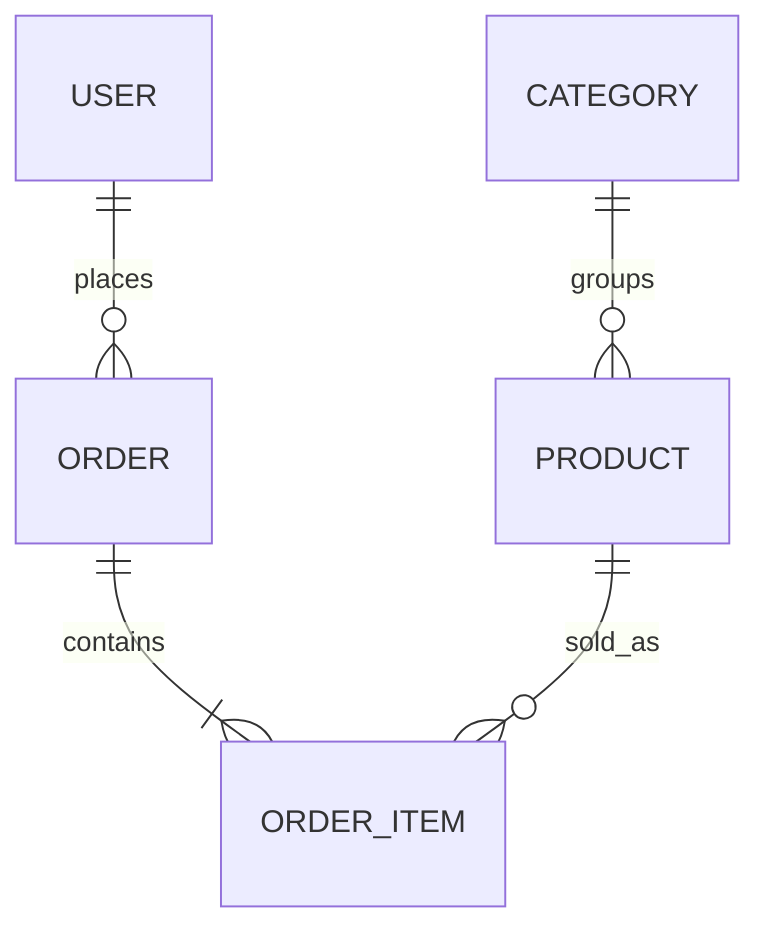
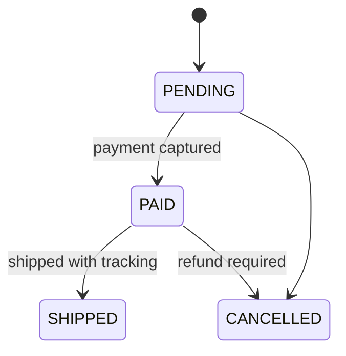

# Business Domain Map

> Project: Fixture Shop (example) · Date: 2026-11-20

## 1. Domains
| Domain | Purpose | Entities | Owner persona | Public-site features served |
|---|---|---|---|---|
| Catalog | What is sold | Product, Category | Catalog manager | Browse, product page |
| Sales | Selling and fulfilment | Order, OrderItem, Payment | Order staff, Finance | Cart, checkout, order tracking |
| Customers | Who buys | User (customer), Review, Contact message | Support | Account, reviews, contact |
| Marketing | Price incentives | Coupon | Catalog manager | Cart discounts |
| Content | Business-owned text and media | FAQ, Media | Catalog manager | FAQ page, product images |

## 2. Entity relationships

## 3. Lifecycles

| Entity | States | Who may transition | Side effects | Evidence |
|---|---|---|---|---|
| Order | PENDING, PAID, SHIPPED, CANCELLED | PAID: system (Stripe webhook); SHIPPED: order_staff; CANCELLED: order_staff (unpaid) / finance (paid) | email, stock, Stripe refund | `OrderStatus` enum |

## 4. Cross-domain effects
| When this changes | …this must happen | Domain(s) |
|---|---|---|
| Order becomes SHIPPED | customer email, stock confirmed | Sales, Customers |
| Order cancelled after PAID | refund + restock decision | Sales, Catalog |

## 5. Data ownership & sensitivity
| Entity | Created by | Edited by | PII / financial? | Retention / deletion rule |
|---|---|---|---|---|
| Order | customer | staff via transitions | financial + address | keep 5+ years, never hard delete |
| User (customer) | customer | support (limited) | PII | anonymise on request |
