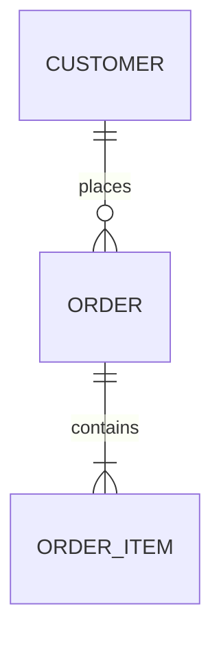
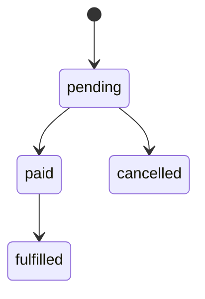

# Business Domain Map

> Project: <name> · Date: <YYYY-MM-DD>

## 1. Domains
| Domain | Purpose | Entities | Owner persona | Public-site features served |
|---|---|---|---|---|

## 2. Entity relationships

## 3. Lifecycles
For every entity with a status/lifecycle (use enums found in code):

| Entity | States | Who may transition | Side effects | Evidence |
|---|---|---|---|---|

## 4. Cross-domain effects
| When this changes | …this must happen | Domain(s) |
|---|---|---|

## 5. Data ownership & sensitivity
| Entity | Created by | Edited by | PII / financial? | Retention / deletion rule |
|---|---|---|---|---|
